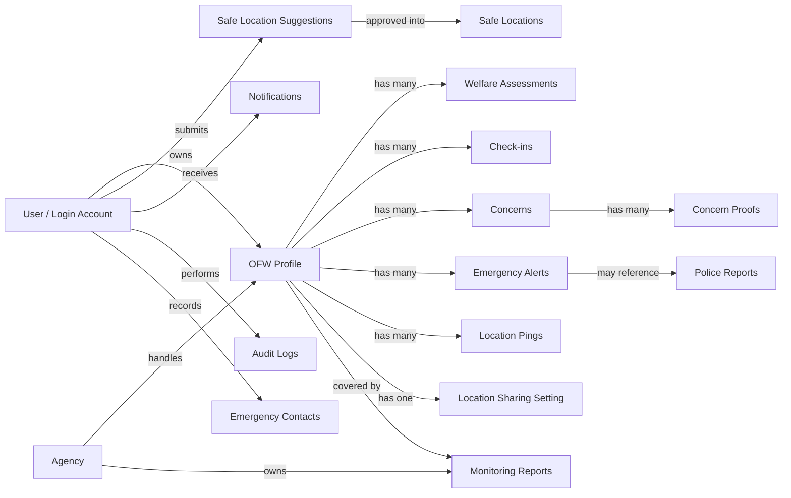
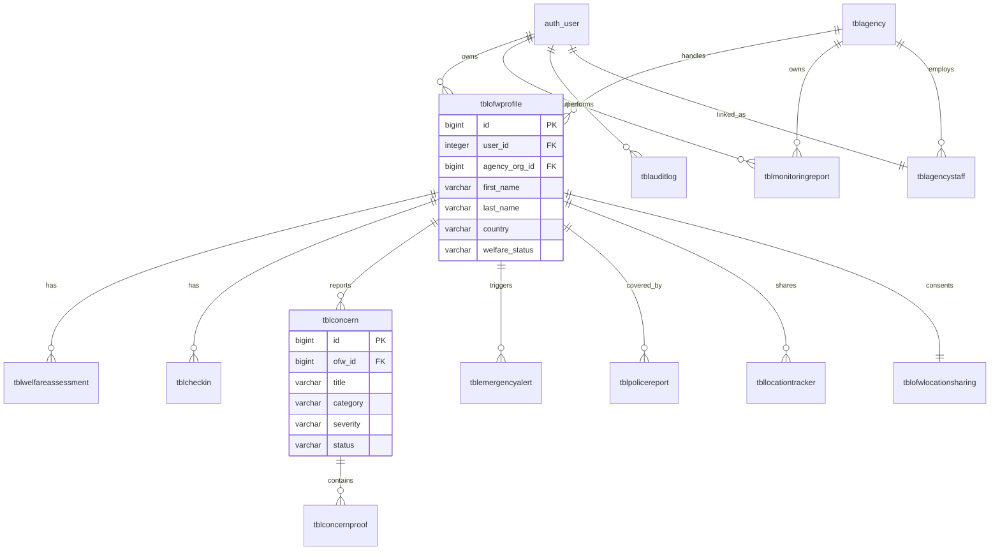
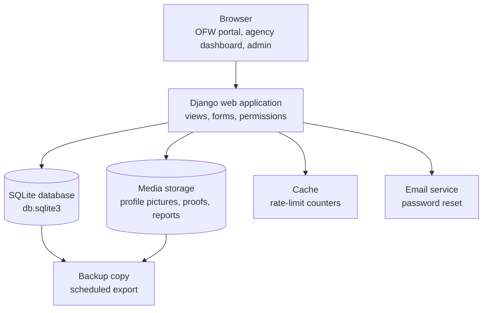
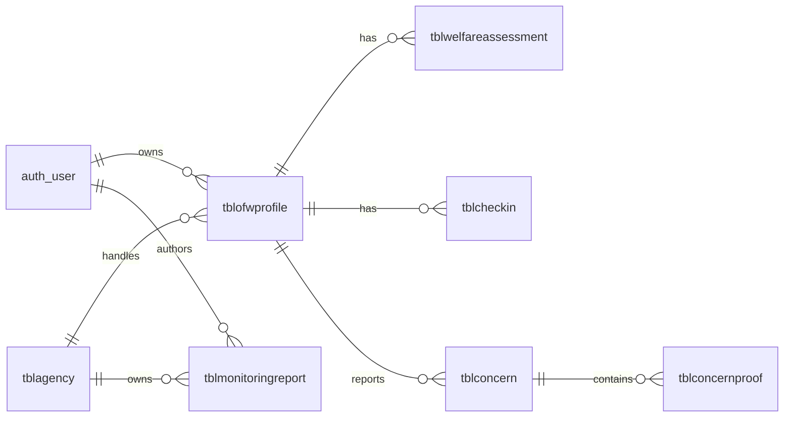
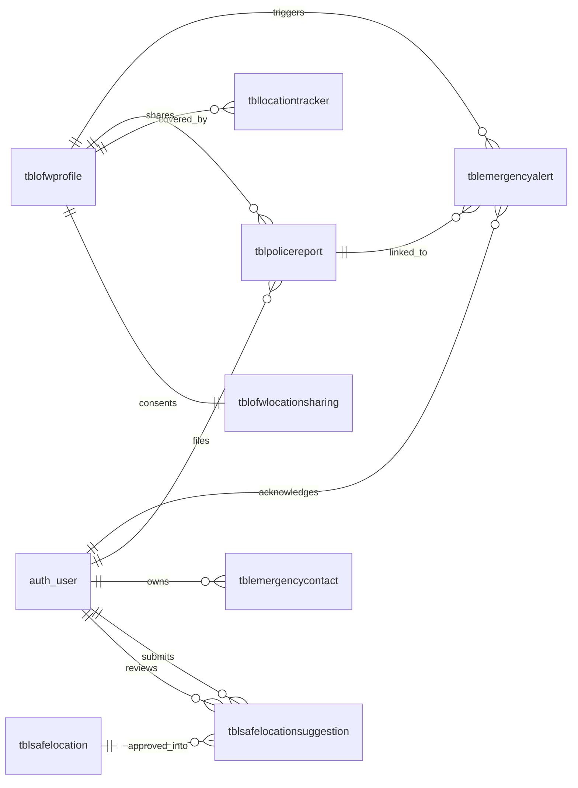
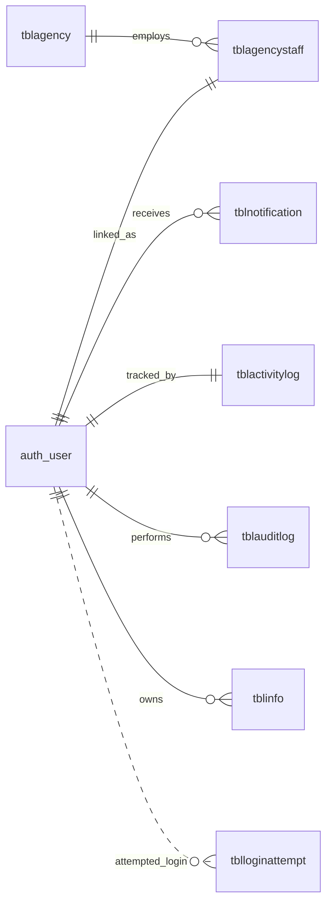

# KABAYANITRACK

## A Web-Based OFW Monitoring and Support Information System

### Database Design Project

---

**Republic of the Philippines**

**[School Name]**

**College of Management and Accounting Technology**

**[School Address]**

---

In Partial Fulfillment of the Requirements for the Degree

**BACHELOR OF SCIENCE IN INFORMATION TECHNOLOGY**

---

**Submitted by: The Errors**

- Eduardo S. Caballeda Jr.
- John Paul B. Canoy
- Xymer John A. Adino

**Date:** November 2026

---

## Table of Contents

1. [Proposed System Description](#1-proposed-system-description)
2. [Conceptual Design](#2-conceptual-design)
3. [Logical Design](#3-logical-design)
4. [Physical Design](#4-physical-design)
5. [List of Tables](#5-list-of-tables)
6. [Data Dictionary](#6-data-dictionary)
7. [Entity-Relationship Diagram](#7-entity-relationship-diagram)
8. [SQL Implementation](#8-sql-implementation)
   - [30 SELECT Statements](#81-30-select-statements)
   - [10 INSERT Statements](#82-10-insert-statements)
   - [10 UPDATE Statements](#83-10-update-statements)
   - [5 DELETE Statements](#84-5-delete-statements)
   - [5 Subquery Statements](#85-5-subquery-statements)
   - [10 JOIN Statements](#86-10-join-statements)
9. [Security, Privacy, and Data Governance](#9-security-privacy-and-data-governance)
10. [Deployment and Maintenance](#10-deployment-and-maintenance)
11. [Appendix A: Index Summary](#appendix-a-index-summary)
12. [Appendix B: Controlled Choice Values](#appendix-b-controlled-choice-values)
13. [Appendix C: Reproducing the SQL Outputs](#appendix-c-reproducing-the-sql-outputs)

---

# 1. PROPOSED SYSTEM DESCRIPTION

KabayaniTrack is a web-based monitoring and support information system for Overseas Filipino Workers (OFWs). It gives recruitment agencies, welfare officers, and system administrators a single place to monitor the welfare of OFWs, record check-ins, manage reported concerns, and respond to emergencies. It also gives OFWs a self-service portal where they can update their profile, submit a concern, view emergency contacts, share their location with consent, and send an SOS alert.

The system replaces scattered spreadsheets, chat threads, and paper case logs with one structured database. Every OFW profile is linked to a login account and, when applicable, to a recruitment agency. Welfare assessments, check-ins, concerns, proof files, emergency alerts, police reports, and monitoring reports are stored as separate but related records, so the history of a case can be reviewed without losing context.

Agency staff and administrators use a management dashboard to see how many OFWs are active, how many need support or are in distress, which concerns are still open, and which accounts have been inactive for several days. The system automatically raises login warnings and emergency alerts for inactive OFWs. If an OFW cannot be reached, staff can record a police report and escalate the case.

The OFW portal is consent-based. Location sharing is disabled by default and can only be enabled by the OFW. An SOS alert is an explicit action by the OFW. Location pings are stored only when the OFW sends an SOS or turns on live sharing; the system does not track location silently.

The database also supports accountability. Management actions such as creating, updating, deleting, or exporting records are written to an audit log with the user, timestamp, affected record, changed fields, and IP address. This gives the capstone project a defensible record of who changed what and when.

KabayaniTrack is implemented with Django and SQLite. The production deployment runs on PythonAnywhere. The interface is responsive, uses role-based access, paginates long lists, and exports monitoring records to Excel or CSV for reporting.

## 1.1 Objectives

**General objective:** To design and implement a centralized, secure, and consent-based database system that monitors the welfare of OFWs and supports timely intervention.

**Specific objectives:**

1. Maintain a complete and searchable profile for every OFW, including deployment, employer, agency, and welfare status.
2. Record periodic welfare assessments and check-ins with their method, condition, and case notes.
3. Manage reported concerns from submission to resolution, including photo or video proof.
4. Provide a directory of emergency contacts, embassies, POLO/OWWA offices, police stations, hospitals, and other safe places.
5. Detect inactive OFW accounts and alert management for follow-up and escalation.
6. Support emergency response through SOS alerts, location pings, safe-place guidance, and police reports.
7. Enforce role-based access so OFWs, agency staff, and administrators see only the records they are allowed to see.
8. Keep an audit trail of management actions for accountability and case review.
9. Generate monitoring reports and export monitoring data for agency and administrative use.
10. Protect privacy by making location sharing opt-in and by collecting only the data needed for welfare monitoring.

## 1.2 Scope and Delimitation

**In scope:**

- OFW registration, login, profile management, and account activity monitoring
- Welfare assessments, check-ins, concerns, concern proofs, and emergency contacts
- Emergency alerts, police reports, safe locations, safe-location suggestions, and location pings
- Consent-based live location sharing
- Monitoring reports, notifications, audit logs, and login-attempt tracking
- Agency management and agency staff assignment
- Dashboard statistics, charts, search, filtering, pagination, and Excel/CSV export

**Out of scope:**

- Payroll, remittance, recruitment processing, and visa processing
- Real-time chat or video calling
- Automatic location tracking without the OFW's consent
- Integration with government databases or police dispatch systems
- Native mobile applications (the system is web-based and responsive)
- Offline operation

## 1.3 System Users and Roles

| Role | Description | Main Capabilities |
|---|---|---|
| **OFW** | A registered overseas Filipino worker | Maintain own profile, submit check-ins and concerns, upload proof, view emergency contacts and safe places, manage consent-based location sharing, send SOS |
| **Agency Staff** | A management user linked to one recruitment agency | View and manage OFWs and records belonging to the agency, monitor inactivity, respond to alerts, prepare reports |
| **Administrator** | A staff or superuser account with system-wide access | Manage all records and agencies, review safe-location suggestions, view audit logs, export data, delete records |
| **Superuser** | The highest-privilege account | All administrator capabilities plus user management, audit-log access, and bulk deletion |

## 1.4 Core Modules

| Module | Purpose | Main Tables |
|---|---|---|
| Authentication and accounts | Login, registration, role checks, login lockout | `auth_user`, `tblloginattempt`, `tblagencystaff` |
| OFW profiles | Personal, employment, and deployment information | `tblofwprofile`, `tblagency` |
| Welfare monitoring | Assessments, check-ins, and welfare status | `tblwelfareassessment`, `tblcheckin` |
| Case management | Concerns, severity, status, and proof files | `tblconcern`, `tblconcernproof` |
| Emergency response | Alerts, police reports, safe places, SOS, location pings | `tblemergencyalert`, `tblpolicereport`, `tblsafelocation`, `tbllocationtracker`, `tblofwlocationsharing` |
| Directory | Emergency contacts, embassies, hotlines | `tblemergencycontact` |
| Reporting | Monitoring reports and exports | `tblmonitoringreport`, `tblofwprofile`, `tblcheckin`, `tblconcern` |
| Activity monitoring | Inactive-account detection and warnings | `tblactivitylog`, `tblnotification` |
| Administration | Agencies, staff links, audit trail | `tblagency`, `tblagencystaff`, `tblauditlog` |
| Shared information | Simple personal-information records used by the application | `tblinfo` |

---

# 2. CONCEPTUAL DESIGN

The conceptual design describes the business objects of KabayaniTrack and the rules that connect them, independent of the database engine.

## 2.1 Core Business Entities

| Entity | Business Meaning |
|---|---|
| **OFW** | An overseas Filipino worker whose welfare is monitored. An OFW may have a login account and may belong to one agency. |
| **Agency** | A recruitment agency or partner office that handles a group of OFWs. |
| **Agency Staff** | A management user assigned to exactly one agency. |
| **Welfare Assessment** | A point-in-time evaluation of an OFW's welfare status and risk level. |
| **Check-in** | A periodic contact with an OFW through an app, SMS, email, call, video call, or in-person visit. |
| **Concern** | A welfare issue reported for an OFW, such as salary, contract, health, abuse, documents, illegal recruitment, or work environment. |
| **Concern Proof** | A photo or video attached to a concern as evidence. |
| **Emergency Contact** | A hotline, embassy, POLO/OWWA office, police station, hospital, employer, family member, or other contact. |
| **Emergency Alert** | A priority warning raised for an inactive or distressed OFW. |
| **Police Report** | A record of police contact or escalation for an unresponsive OFW. |
| **Safe Location** | A police station, hospital, embassy, POLO/OWWA office, fire station, or other safe place near an OFW. |
| **Safe Location Suggestion** | An OFW-submitted candidate safe place pending management approval. |
| **Location Ping** | A latitude/longitude reading explicitly shared during an SOS or opt-in live sharing. |
| **Location Sharing Setting** | The OFW's explicit consent state for ongoing location sharing. |
| **Monitoring Report** | A consolidated monthly, quarterly, annual, incident, or case report. |
| **Notification** | An in-app message delivered to one user. |
| **OFW Activity** | The OFW's last login/activity, inactivity days, and warning/escalation timestamps. |
| **Audit Log** | A record of a management action for accountability. |
| **Login Attempt** | A failed-login counter for a username and IP pair. |
| **Info** | A simple personal-information record used by the shared information module. |

## 2.2 Conceptual Model



## 2.3 Business Rules

1. An OFW profile may exist without a login account (for imported records), but a login account can own multiple OFW profiles.
2. An OFW may be linked to zero or one agency. Deleting an agency must not delete the OFW; the link becomes null.
3. A welfare assessment, check-in, concern, emergency alert, police report, or location ping must belong to exactly one OFW.
4. Deleting an OFW cascades to that OFW's assessments, check-ins, concerns, proofs, alerts, police reports, location pings, and location-sharing setting.
5. A concern may have zero or many proof files. A proof file belongs to exactly one concern.
6. A personal emergency contact may be owned by a user. Public hotlines and directory entries may have no owner.
7. An emergency alert may be acknowledged by one user and may reference one police report.
8. A police report must have a reporting user.
9. A monitoring report may be linked to one agency and may have one author.
10. A safe-location suggestion is submitted by one user and may be reviewed by one user. Approval copies the suggestion into the safe-location directory; the suggestion itself is retained for history.
11. Location sharing is opt-in. No location ping is created unless the OFW sends an SOS or enables live sharing.
12. An audit-log entry may outlive the user who performed the action; the user reference becomes null when the account is deleted.
13. A login attempt is identified by a unique username/IP key and is independent of the user table.

---

# 3. LOGICAL DESIGN

The logical design converts the conceptual model into relational tables. Every table has a surrogate primary key named `id`. Foreign keys use the `<entity>_id` naming convention.

## 3.1 Relational Schema

Notation: **PK** = primary key, **FK** = foreign key, **U** = unique, **N** = not null.

```text
tblofwprofile(id PK, user_id FK→auth_user, agency_org_id FK→tblagency,
              first_name N, middle_name N, last_name N, suffix N,
              passport_number N, birth_date, age, sex N,
              contact_number N, email N, permanent_address N,
              country N, city_abroad N, employer_name N, occupation N,
              agency N, deployment_date, contract_end_date,
              welfare_status N, remarks N, profile_picture N,
              created_at N, updated_at N)

tblwelfareassessment(id PK, ofw_id FK→tblofwprofile, user_id FK→auth_user,
                     status N, risk_level N, assessment_date N,
                     assessor N, notes N, created_at N, updated_at N)

tblcheckin(id PK, ofw_id FK→tblofwprofile, user_id FK→auth_user,
           checkin_date N, method N, condition N, contact_person N,
           notes N, created_at N, updated_at N)

tblconcern(id PK, ofw_id FK→tblofwprofile, user_id FK→auth_user,
           title N, category N, severity N, status N,
           reported_date N, description N, resolved_date,
           read_by_management_at, created_at N, updated_at N)

tblconcernproof(id PK, concern_id FK→tblconcern, file N,
                original_name N, caption N, uploaded_at N)

tblemergencycontact(id PK, user_id FK→auth_user, name N, contact_type N,
                    relationship N, country N, city N, phone N, email N,
                    website N, address N, notes N,
                    created_at N, updated_at N)

tblnotification(id PK, recipient_id FK→auth_user, title N, message N,
                url N, level N, is_read N, created_at N)

tblactivitylog(id PK, user_id FK→auth_user U, last_login_at,
               last_activity_at, is_account_active N, days_inactive N,
               warning_sent_at, followup_sent_at, escalated_to_police_at,
               created_at N, updated_at N)

tblemergencyalert(id PK, ofw_id FK→tblofwprofile, title N, message N,
                  level N, status N, acknowledged_by_id FK→auth_user,
                  acknowledged_at, escalated_to_police N,
                  police_report_id FK→tblpolicereport,
                  created_at N, updated_at N)

tblpolicereport(id PK, ofw_id FK→tblofwprofile, title N, description N,
                police_station N, police_contact N, status N,
                reported_by_id FK→auth_user N, reported_at N, updated_at N)

tblsafelocation(id PK, name N, location_type N, country N, city N,
                address N, phone N, latitude, longitude, is_active N,
                created_at N, updated_at N)

tbllocationtracker(id PK, ofw_id FK→tblofwprofile, latitude N, longitude N,
                   location_label N, accuracy_meters, is_emergency N,
                   recorded_at N)

tblofwlocationsharing(id PK, ofw_id FK→tblofwprofile U,
                      is_enabled N, enabled_at, updated_at N)

tblmonitoringreport(id PK, user_id FK→auth_user, title N, report_type N,
                    period_start N, period_end N, country N, summary N,
                    status N, agency_id FK→tblagency, attachment,
                    created_at N, updated_at N)

tblsafelocationsuggestion(id PK, submitted_by_id FK→auth_user N, name N,
                          location_type N, country N, city N, address N,
                          phone N, latitude, longitude, notes N, status N,
                          reviewed_by_id FK→auth_user, reviewed_at,
                          created_at N, updated_at N)

tblauditlog(id PK, user_id FK→auth_user, action N, model_name N,
            object_id N, object_repr N, changes N, ip_address,
            created_at N)

tblagency(id PK, name N U, slug N U, website N, category N, address N,
          phone N, email N, description N, is_active N, created_at N)

tblagencystaff(id PK, user_id FK→auth_user N U, agency_id FK→tblagency N,
               created_at N)

tblloginattempt(id PK, key N U, failed_attempts N, locked_until, updated_at N)

tblinfo(id PK, name N, age N, address N, email N,
        user_id FK→auth_user, created_at N, updated_at N)
```

## 3.2 Normalization

The design follows the first three normal forms.

- **First normal form (1NF):** Each column stores one atomic value. Multi-valued information such as concern proofs, check-ins, and assessments is placed in separate tables rather than in comma-separated columns.
- **Second normal form (2NF):** Every non-key column depends on the whole primary key. Because the tables use single-column surrogate keys, partial dependency is avoided.
- **Third normal form (3NF):** Descriptive data is stored once. Agency names live in `tblagency`, not repeated in every OFW row. The legacy `tblofwprofile.agency` text column is retained only for imported records; new records use `agency_org_id`.
- **Controlled redundancy:** `tblactivitylog.days_inactive` is a cached value computed from activity timestamps. `tblwelfareassessment.status` and `tblcheckin.condition` are point-in-time snapshots, so they are intentionally not derived from the current profile status.
- **Generic audit reference:** `tblauditlog` stores `model_name` and `object_id` instead of a foreign key to every possible table. This is a deliberate design choice so one audit table can cover all management actions.

## 3.3 Logical Design Diagram

The diagram below shows the main relational structure. The complete ERD with all 20 tables is in Section 7.



---

# 4. PHYSICAL DESIGN

## 4.1 Database Platform

| Item | Value |
|---|---|
| DBMS | SQLite 3 |
| Django backend | `django.db.backends.sqlite3` |
| Production host | PythonAnywhere |
| Database file | `db.sqlite3` in the project root |
| Connection timeout | 20 seconds (configured to reduce "database is locked" errors) |
| Character data | UTF-8 |
| Primary keys | Auto-incrementing `BIGINT` (`BigAutoField`) |
| Timestamps | `DATETIME`, stored in UTC by Django |
| File uploads | Stored on disk under `media/`; only the relative path is stored in the database |

## 4.2 Naming Conventions

- Table names use the `tbl` prefix and lowercase snake case, for example `tblofwprofile`.
- Column names use lowercase snake case.
- Foreign keys use the `<entity>_id` suffix, for example `ofw_id` and `agency_org_id`.
- Many-to-many relationships are avoided; explicit join tables such as `tblagencystaff` are used when needed.
- Choice fields store short lowercase codes such as `active`, `needs_support`, and `distressed`.

## 4.3 Data Types

| Logical type | Physical type | Example |
|---|---|---|
| Identifier | `BIGINT` / `INTEGER` | `tblofwprofile.id` |
| Short text | `VARCHAR(n)` | `first_name VARCHAR(120)` |
| Long text | `TEXT` | `remarks`, `description`, `changes` |
| Date | `DATE` | `birth_date`, `reported_date` |
| Date and time | `DATETIME` | `checkin_date`, `created_at` |
| Boolean | `BOOLEAN` (SQLite integer 0/1) | `is_read`, `is_active` |
| Decimal coordinate | `DECIMAL(9,6)` | `latitude`, `longitude` |
| IP address | `VARCHAR(39)` | `tblauditlog.ip_address` |
| File path | `VARCHAR(100)` | `profile_picture`, `attachment`, `file` |

## 4.4 Referential Actions

| Child table | Foreign key | On delete | Reason |
|---|---|---|---|
| `tblofwprofile` | `user_id` | CASCADE | Remove the profile when its login account is removed |
| `tblofwprofile` | `agency_org_id` | SET NULL | Keep the OFW record when an agency is removed |
| `tblwelfareassessment` | `ofw_id` | CASCADE | Assessments have no meaning without the OFW |
| `tblcheckin` | `ofw_id` | CASCADE | Check-ins have no meaning without the OFW |
| `tblconcern` | `ofw_id` | CASCADE | Concerns belong to the OFW case history |
| `tblconcernproof` | `concern_id` | CASCADE | Proof files belong to the concern |
| `tblnotification` | `recipient_id` | CASCADE | A deleted user cannot receive notifications |
| `tblactivitylog` | `user_id` | CASCADE | Activity is tied to one account |
| `tblemergencyalert` | `ofw_id` | CASCADE | Alerts belong to the OFW |
| `tblemergencyalert` | `acknowledged_by_id` | SET NULL | Keep the alert even if the responder is deleted |
| `tblemergencyalert` | `police_report_id` | SET NULL | Keep the alert even if the report is removed |
| `tblpolicereport` | `ofw_id` | CASCADE | Reports belong to the OFW |
| `tblpolicereport` | `reported_by_id` | CASCADE | A report must have a reporting user |
| `tbllocationtracker` | `ofw_id` | CASCADE | Pings belong to the OFW |
| `tblofwlocationsharing` | `ofw_id` | CASCADE | One consent setting per OFW |
| `tblmonitoringreport` | `user_id` | CASCADE | Reports are owned by their author |
| `tblmonitoringreport` | `agency_id` | SET NULL | Keep the report when an agency is removed |
| `tblsafelocationsuggestion` | `submitted_by_id` | CASCADE | A suggestion must have a submitter |
| `tblsafelocationsuggestion` | `reviewed_by_id` | SET NULL | Keep the suggestion if the reviewer is deleted |
| `tblauditlog` | `user_id` | SET NULL | Audit history must survive user deletion |
| `tblagencystaff` | `user_id` | CASCADE | Remove the staff link with the account |
| `tblagencystaff` | `agency_id` | CASCADE | Remove staff links with the agency |
| `tblinfo` | `user_id` | CASCADE | Personal information belongs to its user |

## 4.5 Indexes

Indexes are created for foreign keys, status filters, date ordering, and the most common search patterns.

| Index name | Table | Columns | Purpose |
|---|---|---|---|
| `checkin_ofw_date_idx` | `tblcheckin` | `ofw_id`, `checkin_date DESC` | Latest check-ins per OFW |
| `loctrack_ofw_recorded_idx` | `tbllocationtracker` | `ofw_id`, `recorded_at DESC` | Location history per OFW |
| `notif_recipient_read_idx` | `tblnotification` | `recipient_id`, `is_read` | Unread notification badge and inbox |
| `audit_model_date_idx` | `tblauditlog` | `model_name`, `created_at DESC` | Audit search by record type |
| `tblofwprofile_welfare_status_...` | `tblofwprofile` | `welfare_status` | Dashboard counts and filters |
| `tblcheckin_condition_...` | `tblcheckin` | `condition` | Distressed/unreachable filtering |
| `tblconcern_status_...` | `tblconcern` | `status` | Open-case filtering |
| `tblwelfareassessment_status_...` | `tblwelfareassessment` | `status` | Welfare-status reporting |
| `tblactivitylog_last_activity_at_...` | `tblactivitylog` | `last_activity_at` | Inactivity detection |
| `tblemergencyalert_status_...` | `tblemergencyalert` | `status` | Alert queue |
| `tblpolicereport_status_...` | `tblpolicereport` | `status` | Police-report queue |
| `tblmonitoringreport_status_...` | `tblmonitoringreport` | `status` | Report filtering |
| `tblsafelocationsuggestion_status_...` | `tblsafelocationsuggestion` | `status` | Pending-suggestion queue |
| `tblauditlog_action_...` | `tblauditlog` | `action` | Audit filter by action |
| `tblauditlog_created_at_...` | `tblauditlog` | `created_at` | Audit retention and date filtering |

Django also creates automatic indexes for every primary key and unique constraint.

## 4.6 Constraints and Validation

- **Primary keys:** Every table has an auto-incrementing `id`.
- **Unique constraints:** `tblagency.name`, `tblagency.slug`, `tblagencystaff.user_id`, `tblofwlocationsharing.ofw_id`, `tblactivitylog.user_id`, and `tblloginattempt.key`.
- **Numeric checks:** `tblofwprofile.age` is restricted to 1–150; `tblinfo.age` is restricted to 1–150; `PositiveIntegerField` and `PositiveSmallIntegerField` prevent negative counts.
- **Controlled choices:** Choice fields store `VARCHAR` codes. Allowed values are enforced by Django forms, model validation, and the application layer; they are documented in Appendix B.
- **File validation:** Profile pictures, concern proofs, and report attachments are checked for extension and size before saving.
- **Referential integrity:** SQLite foreign-key enforcement is enabled by Django, and the `ON DELETE` behavior follows the table above.

## 4.7 Physical Design Diagram



The application layer is the only component that reads or writes the database. Uploaded files are stored outside the database, and the database keeps only their relative paths. This separation keeps the database small and makes file backup a separate, explicit task.

---

# 5. LIST OF TABLES

KabayaniTrack uses 20 application tables. Django's framework tables (`auth_user`, `django_session`, `django_migrations`, and others) support authentication and migrations but are not redefined here.

| No. | Table | Group | Purpose |
|---|---|---|---|
| 1 | `tblofwprofile` | Core | OFW personal, employment, deployment, and welfare information |
| 2 | `tblwelfareassessment` | Core | Point-in-time welfare assessment and risk level |
| 3 | `tblcheckin` | Core | Periodic check-in contact and condition |
| 4 | `tblconcern` | Core | Reported welfare concern and case status |
| 5 | `tblconcernproof` | Core | Photo or video evidence for a concern |
| 6 | `tblmonitoringreport` | Core | Consolidated monitoring report |
| 7 | `tblemergencycontact` | Emergency | Hotline, embassy, POLO/OWWA, police, hospital, employer, family, or other contact |
| 8 | `tblemergencyalert` | Emergency | Priority warning for an inactive or distressed OFW |
| 9 | `tblpolicereport` | Emergency | Record of police contact or escalation |
| 10 | `tblsafelocation` | Emergency | Directory of safe places near OFW locations |
| 11 | `tblsafelocationsuggestion` | Emergency | OFW-submitted safe-place candidate for review |
| 12 | `tbllocationtracker` | Emergency | Explicitly shared location pings |
| 13 | `tblofwlocationsharing` | Emergency | OFW consent state for live location sharing |
| 14 | `tblagency` | Administration | Recruitment agency or partner office |
| 15 | `tblagencystaff` | Administration | Link between a management user and one agency |
| 16 | `tblnotification` | Administration | In-app notification for one user |
| 17 | `tblactivitylog` | Administration | OFW login/activity and inactivity tracking |
| 18 | `tblauditlog` | Administration | Audit trail of management actions |
| 19 | `tblloginattempt` | Administration | Failed-login counter for a username and IP pair |
| 20 | `tblinfo` | Shared | Simple personal-information record |

---

# 6. DATA DICTIONARY

The following dictionary uses the physical schema created by Django migrations. `Length` is the declared maximum character length for `VARCHAR` fields; `—` means not applicable.

## 6.1 Table: `tblofwprofile`

| Field | Description | Type | Length | Constraints |
|---|---|---|---|---|
| `id` | Internal profile identifier | BIGINT | — | PK, auto-increment |
| `user_id` | Login account linked to this profile | INTEGER | — | FK → `auth_user(id)`, NULL, ON DELETE CASCADE |
| `profile_picture` | Relative path of the uploaded profile photo | VARCHAR | 100 | NOT NULL, blank allowed |
| `first_name` | OFW's first name | VARCHAR | 120 | NOT NULL |
| `middle_name` | OFW's middle name | VARCHAR | 120 | NOT NULL, blank allowed |
| `last_name` | OFW's last name | VARCHAR | 120 | NOT NULL |
| `suffix` | Name suffix (Jr., Sr., II, III, IV, V) | VARCHAR | 30 | NOT NULL, controlled choice |
| `passport_number` | Passport number | VARCHAR | 40 | NOT NULL, blank allowed |
| `birth_date` | Date of birth | DATE | — | NULL |
| `age` | Age in years | INTEGER | — | NULL, CHECK 1–150 |
| `sex` | Sex (M = male, F = female) | VARCHAR | 1 | NOT NULL, controlled choice |
| `contact_number` | Local or overseas contact number | VARCHAR | 40 | NOT NULL, blank allowed |
| `email` | Email address | VARCHAR | 255 | NOT NULL, blank allowed |
| `permanent_address` | Philippine permanent address | VARCHAR | 255 | NOT NULL, blank allowed |
| `country` | Country of deployment | VARCHAR | 120 | NOT NULL |
| `city_abroad` | City of deployment | VARCHAR | 120 | NOT NULL, blank allowed |
| `employer_name` | Name of the foreign employer | VARCHAR | 200 | NOT NULL, blank allowed |
| `occupation` | Job title or occupation | VARCHAR | 120 | NOT NULL, blank allowed |
| `agency` | Legacy free-text agency name for imported records | VARCHAR | 200 | NOT NULL, blank allowed |
| `agency_org_id` | Agency that handles this OFW | BIGINT | — | FK → `tblagency(id)`, NULL, ON DELETE SET NULL |
| `deployment_date` | Date of deployment | DATE | — | NULL |
| `contract_end_date` | End date of the employment contract | DATE | — | NULL |
| `welfare_status` | Current welfare status | VARCHAR | 20 | NOT NULL, default `active`, controlled choice, INDEX |
| `remarks` | Free-text case remarks | TEXT | — | NOT NULL, blank allowed |
| `created_at` | Record creation date and time | DATETIME | — | NOT NULL, auto |
| `updated_at` | Last update date and time | DATETIME | — | NOT NULL, auto |

## 6.2 Table: `tblwelfareassessment`

| Field | Description | Type | Length | Constraints |
|---|---|---|---|---|
| `id` | Assessment identifier | BIGINT | — | PK, auto-increment |
| `ofw_id` | OFW being assessed | BIGINT | — | FK → `tblofwprofile(id)`, NOT NULL, ON DELETE CASCADE |
| `user_id` | User who recorded the assessment | INTEGER | — | FK → `auth_user(id)`, NULL, ON DELETE CASCADE |
| `status` | Welfare status at assessment time | VARCHAR | 20 | NOT NULL, controlled choice, INDEX |
| `risk_level` | Risk level (low, medium, high, critical) | VARCHAR | 10 | NOT NULL, default `low`, controlled choice |
| `assessment_date` | Date of assessment | DATE | — | NOT NULL |
| `assessor` | Name of the case officer or assessor | VARCHAR | 200 | NOT NULL, blank allowed |
| `notes` | Assessment findings and recommendations | TEXT | — | NOT NULL, blank allowed |
| `created_at` | Record creation date and time | DATETIME | — | NOT NULL, auto |
| `updated_at` | Last update date and time | DATETIME | — | NOT NULL, auto |

## 6.3 Table: `tblcheckin`

| Field | Description | Type | Length | Constraints |
|---|---|---|---|---|
| `id` | Check-in identifier | BIGINT | — | PK, auto-increment |
| `ofw_id` | OFW who was checked | BIGINT | — | FK → `tblofwprofile(id)`, NOT NULL, ON DELETE CASCADE |
| `user_id` | User who recorded the check-in | INTEGER | — | FK → `auth_user(id)`, NULL, ON DELETE CASCADE |
| `checkin_date` | Date and time of the check-in | DATETIME | — | NOT NULL |
| `method` | Contact method (app, SMS, email, call, video, in person) | VARCHAR | 20 | NOT NULL, default `call`, controlled choice |
| `condition` | OFW condition (safe, needs assistance, distressed, unreachable) | VARCHAR | 20 | NOT NULL, default `safe`, controlled choice, INDEX |
| `contact_person` | Person called or who made contact | VARCHAR | 200 | NOT NULL, blank allowed |
| `notes` | Check-in notes | TEXT | — | NOT NULL, blank allowed |
| `created_at` | Record creation date and time | DATETIME | — | NOT NULL, auto |
| `updated_at` | Last update date and time | DATETIME | — | NOT NULL, auto |
| — | Composite index on `ofw_id` and `checkin_date` | — | — | INDEX `checkin_ofw_date_idx` |

## 6.4 Table: `tblconcern`

| Field | Description | Type | Length | Constraints |
|---|---|---|---|---|
| `id` | Concern identifier | BIGINT | — | PK, auto-increment |
| `ofw_id` | OFW affected by the concern | BIGINT | — | FK → `tblofwprofile(id)`, NOT NULL, ON DELETE CASCADE |
| `user_id` | User who reported or recorded the concern | INTEGER | — | FK → `auth_user(id)`, NULL, ON DELETE CASCADE |
| `title` | Short concern title | VARCHAR | 200 | NOT NULL |
| `category` | Concern category | VARCHAR | 30 | NOT NULL, default `other`, controlled choice |
| `severity` | Severity level | VARCHAR | 10 | NOT NULL, default `medium`, controlled choice |
| `status` | Case status (open, in progress, escalated, resolved, closed) | VARCHAR | 20 | NOT NULL, default `open`, controlled choice, INDEX |
| `reported_date` | Date the concern was reported | DATE | — | NOT NULL |
| `description` | Detailed description of the concern | TEXT | — | NOT NULL, blank allowed |
| `resolved_date` | Date the concern was resolved | DATE | — | NULL |
| `read_by_management_at` | When management first opened the concern | DATETIME | — | NULL |
| `created_at` | Record creation date and time | DATETIME | — | NOT NULL, auto |
| `updated_at` | Last update date and time | DATETIME | — | NOT NULL, auto |

## 6.5 Table: `tblconcernproof`

| Field | Description | Type | Length | Constraints |
|---|---|---|---|---|
| `id` | Proof identifier | BIGINT | — | PK, auto-increment |
| `concern_id` | Concern that owns the proof | BIGINT | — | FK → `tblconcern(id)`, NOT NULL, ON DELETE CASCADE |
| `file` | Relative path of the uploaded photo or video | VARCHAR | 100 | NOT NULL |
| `original_name` | Original file name supplied by the user | VARCHAR | 255 | NOT NULL, blank allowed |
| `caption` | Optional description of the proof | VARCHAR | 255 | NOT NULL, blank allowed |
| `uploaded_at` | Upload date and time | DATETIME | — | NOT NULL, auto |

## 6.6 Table: `tblemergencycontact`

| Field | Description | Type | Length | Constraints |
|---|---|---|---|---|
| `id` | Contact identifier | BIGINT | — | PK, auto-increment |
| `user_id` | Owner of a personal contact; NULL for public directory entries | INTEGER | — | FK → `auth_user(id)`, NULL, ON DELETE CASCADE |
| `name` | Person or office to contact | VARCHAR | 200 | NOT NULL |
| `contact_type` | Contact type (emergency, embassy, POLO, OWWA, DMW, police, fire, hospital, agency, employer, family, other) | VARCHAR | 20 | NOT NULL, default `other`, controlled choice |
| `relationship` | Relationship to the OFW, if personal | VARCHAR | 120 | NOT NULL, blank allowed |
| `country` | Country where the contact applies | VARCHAR | 120 | NOT NULL, blank allowed |
| `city` | City where the contact applies | VARCHAR | 120 | NOT NULL, blank allowed |
| `phone` | Telephone or hotline number | VARCHAR | 60 | NOT NULL |
| `email` | Email address | VARCHAR | 255 | NOT NULL, blank allowed |
| `website` | Official website | VARCHAR | 255 | NOT NULL, blank allowed |
| `address` | Physical address | VARCHAR | 255 | NOT NULL, blank allowed |
| `notes` | Additional instructions | TEXT | — | NOT NULL, blank allowed |
| `created_at` | Record creation date and time | DATETIME | — | NOT NULL, auto |
| `updated_at` | Last update date and time | DATETIME | — | NOT NULL, auto |

## 6.7 Table: `tblnotification`

| Field | Description | Type | Length | Constraints |
|---|---|---|---|---|
| `id` | Notification identifier | BIGINT | — | PK, auto-increment |
| `recipient_id` | User who receives the notification | INTEGER | — | FK → `auth_user(id)`, NOT NULL, ON DELETE CASCADE |
| `title` | Notification title | VARCHAR | 200 | NOT NULL |
| `message` | Notification body | TEXT | — | NOT NULL, blank allowed |
| `url` | In-app link opened by the notification | VARCHAR | 500 | NOT NULL, blank allowed |
| `level` | Visual level (info, success, warning, danger) | VARCHAR | 10 | NOT NULL, default `info`, controlled choice |
| `is_read` | Whether the recipient has read it | BOOLEAN | 1 | NOT NULL, default false |
| `created_at` | Notification date and time | DATETIME | — | NOT NULL, auto |
| — | Composite index on `recipient_id` and `is_read` | — | — | INDEX `notif_recipient_read_idx` |

## 6.8 Table: `tblactivitylog`

| Field | Description | Type | Length | Constraints |
|---|---|---|---|---|
| `id` | Activity record identifier | BIGINT | — | PK, auto-increment |
| `user_id` | OFW login account being monitored | INTEGER | — | FK → `auth_user(id)`, NOT NULL, UNIQUE, ON DELETE CASCADE |
| `last_login_at` | Last successful login | DATETIME | — | NULL |
| `last_activity_at` | Most recent login or profile update | DATETIME | — | NULL, INDEX |
| `is_account_active` | Whether the account is considered active | BOOLEAN | 1 | NOT NULL, default true |
| `days_inactive` | Cached number of inactive days | INTEGER | — | NOT NULL, default 0, CHECK ≥ 0 |
| `warning_sent_at` | When the inactivity warning was sent | DATETIME | — | NULL |
| `followup_sent_at` | When the follow-up reminder was sent | DATETIME | — | NULL |
| `escalated_to_police_at` | When the case was escalated to police | DATETIME | — | NULL |
| `created_at` | Record creation date and time | DATETIME | — | NOT NULL, auto |
| `updated_at` | Last update date and time | DATETIME | — | NOT NULL, auto |

## 6.9 Table: `tblemergencyalert`

| Field | Description | Type | Length | Constraints |
|---|---|---|---|---|
| `id` | Alert identifier | BIGINT | — | PK, auto-increment |
| `ofw_id` | OFW the alert is about | BIGINT | — | FK → `tblofwprofile(id)`, NOT NULL, ON DELETE CASCADE |
| `title` | Alert title | VARCHAR | 200 | NOT NULL |
| `message` | Alert details | TEXT | — | NOT NULL, blank allowed |
| `level` | Alert level (warning, danger, critical) | VARCHAR | 10 | NOT NULL, default `warning`, controlled choice |
| `status` | Alert status (open, acknowledged, escalated, resolved) | VARCHAR | 20 | NOT NULL, default `open`, controlled choice, INDEX |
| `acknowledged_by_id` | User who acknowledged the alert | INTEGER | — | FK → `auth_user(id)`, NULL, ON DELETE SET NULL |
| `acknowledged_at` | When the alert was acknowledged | DATETIME | — | NULL |
| `escalated_to_police` | Whether the case was escalated | BOOLEAN | 1 | NOT NULL, default false |
| `police_report_id` | Police report linked to the alert | BIGINT | — | FK → `tblpolicereport(id)`, NULL, ON DELETE SET NULL |
| `created_at` | Record creation date and time | DATETIME | — | NOT NULL, auto |
| `updated_at` | Last update date and time | DATETIME | — | NOT NULL, auto |

## 6.10 Table: `tblpolicereport`

| Field | Description | Type | Length | Constraints |
|---|---|---|---|---|
| `id` | Police report identifier | BIGINT | — | PK, auto-increment |
| `ofw_id` | OFW covered by the report | BIGINT | — | FK → `tblofwprofile(id)`, NOT NULL, ON DELETE CASCADE |
| `title` | Report title | VARCHAR | 200 | NOT NULL |
| `description` | Narrative of the police contact | TEXT | — | NOT NULL, blank allowed |
| `police_station` | Police station near the OFW | VARCHAR | 200 | NOT NULL, blank allowed |
| `police_contact` | Police hotline or contact number | VARCHAR | 60 | NOT NULL, blank allowed |
| `status` | Report status (draft, submitted, responded, closed) | VARCHAR | 20 | NOT NULL, default `draft`, controlled choice, INDEX |
| `reported_by_id` | Management user who filed the report | INTEGER | — | FK → `auth_user(id)`, NOT NULL, ON DELETE CASCADE |
| `reported_at` | Report creation date and time | DATETIME | — | NOT NULL, auto |
| `updated_at` | Last update date and time | DATETIME | — | NOT NULL, auto |

## 6.11 Table: `tblsafelocation`

| Field | Description | Type | Length | Constraints |
|---|---|---|---|---|
| `id` | Safe-location identifier | BIGINT | — | PK, auto-increment |
| `name` | Name of the safe place | VARCHAR | 200 | NOT NULL |
| `location_type` | Type (police station, hospital, embassy, POLO, OWWA, fire, other) | VARCHAR | 30 | NOT NULL, default `other`, controlled choice |
| `country` | Country | VARCHAR | 120 | NOT NULL |
| `city` | City | VARCHAR | 120 | NOT NULL, blank allowed |
| `address` | Street address | VARCHAR | 255 | NOT NULL, blank allowed |
| `phone` | Contact number | VARCHAR | 60 | NOT NULL, blank allowed |
| `latitude` | Latitude coordinate | DECIMAL | 9,6 | NULL |
| `longitude` | Longitude coordinate | DECIMAL | 9,6 | NULL |
| `is_active` | Whether the place is shown to OFWs | BOOLEAN | 1 | NOT NULL, default true |
| `created_at` | Record creation date and time | DATETIME | — | NOT NULL, auto |
| `updated_at` | Last update date and time | DATETIME | — | NOT NULL, auto |

## 6.12 Table: `tbllocationtracker`

| Field | Description | Type | Length | Constraints |
|---|---|---|---|---|
| `id` | Location-ping identifier | BIGINT | — | PK, auto-increment |
| `ofw_id` | OFW who shared the location | BIGINT | — | FK → `tblofwprofile(id)`, NOT NULL, ON DELETE CASCADE |
| `latitude` | Latitude coordinate | DECIMAL | 9,6 | NOT NULL |
| `longitude` | Longitude coordinate | DECIMAL | 9,6 | NOT NULL |
| `location_label` | Reverse-geocoded address label | VARCHAR | 200 | NOT NULL, blank allowed |
| `accuracy_meters` | Reported GPS accuracy in meters | INTEGER | — | NULL, CHECK ≥ 0 |
| `is_emergency` | True when sent during an SOS | BOOLEAN | 1 | NOT NULL, default false |
| `recorded_at` | Date and time the ping was recorded | DATETIME | — | NOT NULL, auto |
| — | Composite index on `ofw_id` and `recorded_at` | — | — | INDEX `loctrack_ofw_recorded_idx` |

## 6.13 Table: `tblofwlocationsharing`

| Field | Description | Type | Length | Constraints |
|---|---|---|---|---|
| `id` | Consent-setting identifier | BIGINT | — | PK, auto-increment |
| `ofw_id` | OFW whose consent is stored | BIGINT | — | FK → `tblofwprofile(id)`, NOT NULL, UNIQUE, ON DELETE CASCADE |
| `is_enabled` | Whether the OFW has enabled live sharing | BOOLEAN | 1 | NOT NULL, default false |
| `enabled_at` | When sharing was last enabled | DATETIME | — | NULL |
| `updated_at` | Last update date and time | DATETIME | — | NOT NULL, auto |

## 6.14 Table: `tblmonitoringreport`

| Field | Description | Type | Length | Constraints |
|---|---|---|---|---|
| `id` | Report identifier | BIGINT | — | PK, auto-increment |
| `user_id` | Author of the report | INTEGER | — | FK → `auth_user(id)`, NULL, ON DELETE CASCADE |
| `title` | Report title | VARCHAR | 200 | NOT NULL |
| `report_type` | Monthly, quarterly, annual, incident, or case | VARCHAR | 20 | NOT NULL, default `monthly`, controlled choice |
| `period_start` | Start of the reporting period | DATE | — | NOT NULL |
| `period_end` | End of the reporting period | DATE | — | NOT NULL |
| `country` | Country covered by the report | VARCHAR | 120 | NOT NULL, blank allowed |
| `summary` | Report narrative and findings | TEXT | — | NOT NULL, blank allowed |
| `status` | Draft, submitted, or approved | VARCHAR | 20 | NOT NULL, default `draft`, controlled choice, INDEX |
| `agency_id` | Agency that owns the report | BIGINT | — | FK → `tblagency(id)`, NULL, ON DELETE SET NULL |
| `attachment` | Relative path of the uploaded report file | VARCHAR | 100 | NULL |
| `created_at` | Record creation date and time | DATETIME | — | NOT NULL, auto |
| `updated_at` | Last update date and time | DATETIME | — | NOT NULL, auto |

## 6.15 Table: `tblsafelocationsuggestion`

| Field | Description | Type | Length | Constraints |
|---|---|---|---|---|
| `id` | Suggestion identifier | BIGINT | — | PK, auto-increment |
| `submitted_by_id` | User who submitted the suggestion | INTEGER | — | FK → `auth_user(id)`, NOT NULL, ON DELETE CASCADE |
| `name` | Proposed safe-place name | VARCHAR | 200 | NOT NULL |
| `location_type` | Type of safe place | VARCHAR | 30 | NOT NULL, default `other`, controlled choice |
| `country` | Country | VARCHAR | 120 | NOT NULL |
| `city` | City | VARCHAR | 120 | NOT NULL, blank allowed |
| `address` | Street address | VARCHAR | 255 | NOT NULL, blank allowed |
| `phone` | Contact number | VARCHAR | 60 | NOT NULL, blank allowed |
| `latitude` | Latitude coordinate | DECIMAL | 9,6 | NULL |
| `longitude` | Longitude coordinate | DECIMAL | 9,6 | NULL |
| `notes` | Why the place is safe or useful | TEXT | — | NOT NULL, blank allowed |
| `status` | Pending, approved, or rejected | VARCHAR | 20 | NOT NULL, default `pending`, controlled choice, INDEX |
| `reviewed_by_id` | Management user who reviewed it | INTEGER | — | FK → `auth_user(id)`, NULL, ON DELETE SET NULL |
| `reviewed_at` | When it was reviewed | DATETIME | — | NULL |
| `created_at` | Record creation date and time | DATETIME | — | NOT NULL, auto |
| `updated_at` | Last update date and time | DATETIME | — | NOT NULL, auto |

## 6.16 Table: `tblauditlog`

| Field | Description | Type | Length | Constraints |
|---|---|---|---|---|
| `id` | Audit-entry identifier | BIGINT | — | PK, auto-increment |
| `user_id` | User who performed the action | INTEGER | — | FK → `auth_user(id)`, NULL, ON DELETE SET NULL |
| `action` | Action performed (create, update, delete, delete all, export) | VARCHAR | 20 | NOT NULL, controlled choice, INDEX |
| `model_name` | Human-readable record type | VARCHAR | 80 | NOT NULL, blank allowed |
| `object_id` | Primary key of the affected record | VARCHAR | 40 | NOT NULL, blank allowed |
| `object_repr` | Text representation of the affected record | VARCHAR | 255 | NOT NULL, blank allowed |
| `changes` | JSON object describing created or changed fields | TEXT | — | NOT NULL, blank allowed |
| `ip_address` | Client IP address | VARCHAR | 39 | NULL |
| `created_at` | Date and time of the action | DATETIME | — | NOT NULL, auto, INDEX |
| — | Composite index on `model_name` and `created_at` | — | — | INDEX `audit_model_date_idx` |

## 6.17 Table: `tblagency`

| Field | Description | Type | Length | Constraints |
|---|---|---|---|---|
| `id` | Agency identifier | BIGINT | — | PK, auto-increment |
| `name` | Agency name | VARCHAR | 200 | NOT NULL, UNIQUE |
| `slug` | URL-safe agency identifier | VARCHAR | 80 | NOT NULL, UNIQUE |
| `website` | Official website | VARCHAR | 255 | NOT NULL, blank allowed |
| `category` | Agency category | VARCHAR | 200 | NOT NULL, blank allowed |
| `address` | Office address | VARCHAR | 255 | NOT NULL, blank allowed |
| `phone` | Office phone number | VARCHAR | 60 | NOT NULL, blank allowed |
| `email` | Office email address | VARCHAR | 255 | NOT NULL, blank allowed |
| `description` | Agency description | TEXT | — | NOT NULL, blank allowed |
| `is_active` | Whether the agency is active | BOOLEAN | 1 | NOT NULL, default true |
| `created_at` | Record creation date and time | DATETIME | — | NOT NULL, auto |

## 6.18 Table: `tblagencystaff`

| Field | Description | Type | Length | Constraints |
|---|---|---|---|---|
| `id` | Staff-link identifier | BIGINT | — | PK, auto-increment |
| `user_id` | Management user account | INTEGER | — | FK → `auth_user(id)`, NOT NULL, UNIQUE, ON DELETE CASCADE |
| `agency_id` | Agency the user belongs to | BIGINT | — | FK → `tblagency(id)`, NOT NULL, ON DELETE CASCADE |
| `created_at` | Record creation date and time | DATETIME | — | NOT NULL, auto |

## 6.19 Table: `tblloginattempt`

| Field | Description | Type | Length | Constraints |
|---|---|---|---|---|
| `id` | Login-attempt identifier | BIGINT | — | PK, auto-increment |
| `key` | Unique username and IP combination | VARCHAR | 64 | NOT NULL, UNIQUE |
| `failed_attempts` | Consecutive failed attempts | SMALLINT | — | NOT NULL, default 0, CHECK ≥ 0 |
| `locked_until` | Time until which the account/IP is locked | DATETIME | — | NULL |
| `updated_at` | Last update date and time | DATETIME | — | NOT NULL, auto |

## 6.20 Table: `tblinfo`

| Field | Description | Type | Length | Constraints |
|---|---|---|---|---|
| `id` | Information-record identifier | BIGINT | — | PK, auto-increment |
| `name` | Full name | VARCHAR | 255 | NOT NULL |
| `age` | Age in years | INTEGER | — | NOT NULL, CHECK 1–150 |
| `address` | Address | VARCHAR | 255 | NOT NULL |
| `email` | Email address | VARCHAR | 255 | NOT NULL, blank allowed |
| `user_id` | User who owns the record | INTEGER | — | FK → `auth_user(id)`, NULL, ON DELETE CASCADE |
| `created_at` | Record creation date and time | DATETIME | — | NOT NULL, auto |
| `updated_at` | Last update date and time | DATETIME | — | NOT NULL, auto |

---

# 7. ENTITY-RELATIONSHIP DIAGRAM

## 7.1 ERD

Because KabayaniTrack has 20 application tables, the ERD is presented in three readable views. Together they cover every entity and relationship; the Entity Description and Relationship Summary that follow list all 20 tables.

### 7.1.1 Core Monitoring ERD



### 7.1.2 Emergency and Location ERD



### 7.1.3 Administration and Support ERD



> `tblloginattempt` has no foreign key to `auth_user`; the dashed line marks an application-level key relationship. The same convention is used for the approved-copy relationship between a safe-location suggestion and a safe location.


## 7.2 Entity Description

| Entity (table) | Description | Primary Key | Foreign Key(s) | Other Attributes |
|---|---|---|---|---|
| **OFW Profile** (`tblofwprofile`) | Personal, employment, deployment, and welfare record of an OFW | `id` | `user_id`, `agency_org_id` | first_name, middle_name, last_name, suffix, passport_number, birth_date, age, sex, contact_number, email, permanent_address, country, city_abroad, employer_name, occupation, agency, deployment_date, contract_end_date, welfare_status, remarks, profile_picture, timestamps |
| **Welfare Assessment** (`tblwelfareassessment`) | Point-in-time welfare evaluation with risk level | `id` | `ofw_id`, `user_id` | status, risk_level, assessment_date, assessor, notes, timestamps |
| **Check-in** (`tblcheckin`) | Periodic contact with an OFW and the observed condition | `id` | `ofw_id`, `user_id` | checkin_date, method, condition, contact_person, notes, timestamps |
| **Concern** (`tblconcern`) | Welfare case reported for an OFW | `id` | `ofw_id`, `user_id` | title, category, severity, status, reported_date, description, resolved_date, read_by_management_at, timestamps |
| **Concern Proof** (`tblconcernproof`) | Photo or video evidence attached to a concern | `id` | `concern_id` | file, original_name, caption, uploaded_at |
| **Emergency Contact** (`tblemergencycontact`) | Hotline, embassy, POLO/OWWA, police, hospital, employer, family, or other contact | `id` | `user_id` | name, contact_type, relationship, country, city, phone, email, website, address, notes, timestamps |
| **Notification** (`tblnotification`) | In-app message for one user | `id` | `recipient_id` | title, message, url, level, is_read, created_at |
| **OFW Activity** (`tblactivitylog`) | Login/activity state and inactivity escalation timestamps | `id` | `user_id` (unique) | last_login_at, last_activity_at, is_account_active, days_inactive, warning_sent_at, followup_sent_at, escalated_to_police_at, timestamps |
| **Emergency Alert** (`tblemergencyalert`) | Priority warning for an inactive or distressed OFW | `id` | `ofw_id`, `acknowledged_by_id`, `police_report_id` | title, message, level, status, acknowledged_at, escalated_to_police, timestamps |
| **Police Report** (`tblpolicereport`) | Record of police contact or escalation | `id` | `ofw_id`, `reported_by_id` | title, description, police_station, police_contact, status, reported_at, updated_at |
| **Safe Location** (`tblsafelocation`) | Directory entry for a safe place | `id` | — | name, location_type, country, city, address, phone, latitude, longitude, is_active, timestamps |
| **Location Ping** (`tbllocationtracker`) | Location explicitly shared during SOS or live sharing | `id` | `ofw_id` | latitude, longitude, location_label, accuracy_meters, is_emergency, recorded_at |
| **Location Sharing** (`tblofwlocationsharing`) | OFW consent state for live location sharing | `id` | `ofw_id` (unique) | is_enabled, enabled_at, updated_at |
| **Monitoring Report** (`tblmonitoringreport`) | Consolidated monthly, quarterly, annual, incident, or case report | `id` | `user_id`, `agency_id` | title, report_type, period_start, period_end, country, summary, status, attachment, timestamps |
| **Safe Location Suggestion** (`tblsafelocationsuggestion`) | OFW-submitted safe-place candidate for management review | `id` | `submitted_by_id`, `reviewed_by_id` | name, location_type, country, city, address, phone, latitude, longitude, notes, status, reviewed_at, timestamps |
| **Audit Log** (`tblauditlog`) | Record of a management action for accountability | `id` | `user_id` | action, model_name, object_id, object_repr, changes, ip_address, created_at |
| **Agency** (`tblagency`) | Recruitment agency or partner office | `id` | — | name, slug, website, category, address, phone, email, description, is_active, created_at |
| **Agency Staff** (`tblagencystaff`) | Link between a management user and one agency | `id` | `user_id` (unique), `agency_id` | created_at |
| **Login Attempt** (`tblloginattempt`) | Failed-login counter for a username and IP pair | `id` | — | key (unique), failed_attempts, locked_until, updated_at |
| **Info** (`tblinfo`) | Simple personal-information record | `id` | `user_id` | name, age, address, email, timestamps |

## 7.3 Relationship Summary

| Entities | Cardinality | Implemented By | Description |
|---|---|---|---|
| User – OFW Profile | 1:M | `tblofwprofile.user_id → auth_user.id` | One login account can own many OFW profiles; each profile has zero or one account |
| Agency – OFW Profile | 1:M | `tblofwprofile.agency_org_id → tblagency.id` | One agency handles many OFWs; an OFW belongs to zero or one agency |
| User – Agency Staff | 1:1 | `tblagencystaff.user_id → auth_user.id` (unique) | A management user is linked to at most one agency |
| Agency – Agency Staff | 1:M | `tblagencystaff.agency_id → tblagency.id` | One agency can have many staff links |
| OFW – Welfare Assessment | 1:M | `tblwelfareassessment.ofw_id → tblofwprofile.id` | One OFW can have many assessments over time |
| OFW – Check-in | 1:M | `tblcheckin.ofw_id → tblofwprofile.id` | One OFW can have many check-ins |
| OFW – Concern | 1:M | `tblconcern.ofw_id → tblofwprofile.id` | One OFW can report many concerns |
| Concern – Concern Proof | 1:M | `tblconcernproof.concern_id → tblconcern.id` | One concern can have zero or many proof files |
| User – Emergency Contact | 1:M | `tblemergencycontact.user_id → auth_user.id` | One user can own many personal contacts; public contacts have no owner |
| User – Notification | 1:M | `tblnotification.recipient_id → auth_user.id` | One user can receive many notifications |
| User – OFW Activity | 1:1 | `tblactivitylog.user_id → auth_user.id` (unique) | Each OFW login account has one activity record |
| OFW – Emergency Alert | 1:M | `tblemergencyalert.ofw_id → tblofwprofile.id` | One OFW can have many alerts |
| User – Emergency Alert | 1:M | `tblemergencyalert.acknowledged_by_id → auth_user.id` | One user can acknowledge many alerts |
| Police Report – Emergency Alert | 1:M | `tblemergencyalert.police_report_id → tblpolicereport.id` | One police report can be referenced by many alerts |
| OFW – Police Report | 1:M | `tblpolicereport.ofw_id → tblofwprofile.id` | One OFW can have many police reports |
| User – Police Report | 1:M | `tblpolicereport.reported_by_id → auth_user.id` | One user can file many reports |
| OFW – Location Ping | 1:M | `tbllocationtracker.ofw_id → tblofwprofile.id` | One OFW can share many location pings |
| OFW – Location Sharing | 1:1 | `tblofwlocationsharing.ofw_id → tblofwprofile.id` (unique) | Each OFW has one consent setting |
| User – Monitoring Report | 1:M | `tblmonitoringreport.user_id → auth_user.id` | One user can author many reports |
| Agency – Monitoring Report | 1:M | `tblmonitoringreport.agency_id → tblagency.id` | One agency can own many reports |
| User – Safe Location Suggestion (submit) | 1:M | `tblsafelocationsuggestion.submitted_by_id → auth_user.id` | One user can submit many suggestions |
| User – Safe Location Suggestion (review) | 1:M | `tblsafelocationsuggestion.reviewed_by_id → auth_user.id` | One reviewer can act on many suggestions |
| Safe Location – Safe Location Suggestion | 1:M (application rule) | No direct foreign key; approved suggestions are copied into `tblsafelocation` | A suggestion can become a safe location after approval |
| User – Audit Log | 1:M | `tblauditlog.user_id → auth_user.id` | One user can perform many audited actions |
| User – Info | 1:M | `tblinfo.user_id → auth_user.id` | One user can own many information records |
| Login Attempt | Independent | `tblloginattempt.key` (unique) | Not linked by foreign key; the key is a username/IP string |

# 8. SQL IMPLEMENTATION

The SQL in this section is written for **SQLite**, the database engine used by KabayaniTrack. Table and column names match the physical schema in Section 6.

> **About the sample outputs:** The row counts and sample values below come from a disposable copy of the local development database. They are included to show the shape of each result. The live database may return different rows. Appendix C explains how to reproduce the outputs and capture screenshots.

## 8.1 30 SELECT Statements

### 1. Display the full name of all female OFWs

```sql
SELECT first_name || ' ' || last_name AS full_name
FROM tblofwprofile
WHERE sex = 'F'
ORDER BY last_name;
```

**Sample output:** 3 rows — Rocel Mabo, Maria Santos, Ana Villanueva.

### 2. Display active OFWs with their country and city abroad

```sql
SELECT id,
       first_name || ' ' || last_name AS full_name,
       country,
       city_abroad
FROM tblofwprofile
WHERE welfare_status = 'active'
ORDER BY country, last_name;
```

**Sample output:** 6 rows.

### 3. Display OFWs deployed in Qatar

```sql
SELECT id,
       first_name || ' ' || last_name AS full_name,
       employer_name,
       welfare_status
FROM tblofwprofile
WHERE country = 'Qatar';
```

**Sample output:** 3 rows — Jose Ramos, Pedro Reyes, Demo Inactive OFW.

### 4. Display OFWs whose employer name contains "Hospital"

```sql
SELECT first_name || ' ' || last_name AS full_name,
       employer_name,
       country
FROM tblofwprofile
WHERE employer_name LIKE '%Hospital%';
```

**Sample output:** 2 rows — Maria Santos (Emirates Hospital) and Ana Villanueva (Emirates Care Hospital).

### 5. Display OFWs whose age is between 25 and 40

```sql
SELECT first_name || ' ' || last_name AS full_name,
       age,
       country
FROM tblofwprofile
WHERE age BETWEEN 25 AND 40
ORDER BY age;
```

**Sample output:** 3 rows — ages 34, 36, and 40.

### 6. Display OFWs whose contract ends within 2026

```sql
SELECT first_name || ' ' || last_name AS full_name,
       contract_end_date
FROM tblofwprofile
WHERE contract_end_date BETWEEN '2026-01-01' AND '2026-12-31'
ORDER BY contract_end_date;
```

**Sample output:** 2 rows — Maria Santos (2026-07-03) and Jose Ramos (2026-09-01).

### 7. Count OFWs per country

```sql
SELECT country,
       COUNT(*) AS ofw_count
FROM tblofwprofile
GROUP BY country
ORDER BY ofw_count DESC, country;
```

**Sample output:** 6 rows — Qatar has the highest count with 3.

### 8. Count OFWs per welfare status

```sql
SELECT welfare_status,
       COUNT(*) AS total
FROM tblofwprofile
GROUP BY welfare_status
ORDER BY total DESC;
```

**Sample output:** 4 rows — active 6, distressed 2, needs_support 2, repatriated 1.

### 9. Display the average age of OFWs

```sql
SELECT ROUND(AVG(age), 1) AS average_age
FROM tblofwprofile
WHERE age IS NOT NULL;
```

**Sample output:** 1 row — average age 34.8.

### 10. Display the oldest and youngest birth dates

```sql
SELECT MIN(birth_date) AS oldest_birth_date,
       MAX(birth_date) AS youngest_birth_date
FROM tblofwprofile
WHERE birth_date IS NOT NULL;
```

**Sample output:** 1 row — oldest 1983-01-10, youngest 2006-03-04.

### 11. Display OFWs ordered by last name, then first name

```sql
SELECT last_name,
       first_name,
       country
FROM tblofwprofile
ORDER BY last_name ASC, first_name ASC;
```

**Sample output:** 11 rows, starting with Bonos, Dela Cruz, and Garcia.

### 12. Display the check-ins of OFW 19, newest first

```sql
SELECT id,
       checkin_date,
       method,
       condition,
       contact_person
FROM tblcheckin
WHERE ofw_id = 19
ORDER BY checkin_date DESC;
```

**Sample output:** 2 rows.

### 13. Display distressed or unreachable check-ins

```sql
SELECT id,
       ofw_id,
       checkin_date,
       condition,
       notes
FROM tblcheckin
WHERE condition IN ('distressed', 'unreachable')
ORDER BY checkin_date DESC;
```

**Sample output:** 2 rows — one distressed and one unreachable.

### 14. Count check-ins per contact method

```sql
SELECT method,
       COUNT(*) AS total
FROM tblcheckin
GROUP BY method
ORDER BY total DESC;
```

**Sample output:** 5 rows — call 4, video 1, SMS 1, app 1, in-person 1.

### 15. Display the latest check-in date per OFW

```sql
SELECT ofw_id,
       MAX(checkin_date) AS latest_checkin
FROM tblcheckin
GROUP BY ofw_id
ORDER BY latest_checkin DESC;
```

**Sample output:** 6 rows.

### 16. Display open or escalated concerns with high or critical severity

```sql
SELECT id,
       title,
       category,
       severity,
       status
FROM tblconcern
WHERE status IN ('open', 'escalated')
  AND severity IN ('high', 'critical')
ORDER BY reported_date DESC;
```

**Sample output:** 2 rows — contract substitution (critical, escalated) and illegal recruitment (high, open).

### 17. Count concerns per category

```sql
SELECT category,
       COUNT(*) AS total
FROM tblconcern
GROUP BY category
ORDER BY total DESC;
```

**Sample output:** 6 rows, one concern per category in the sample data.

### 18. Display the average number of days to resolve a concern

```sql
SELECT ROUND(AVG(julianday(resolved_date) - julianday(reported_date)), 1)
           AS avg_days_to_resolve
FROM tblconcern
WHERE resolved_date IS NOT NULL;
```

**Sample output:** 1 row — 27.5 days.

### 19. Display concerns reported in the last 30 days

```sql
SELECT id,
       title,
       reported_date,
       status
FROM tblconcern
WHERE reported_date >= date('now', '-30 days')
ORDER BY reported_date DESC;
```

**Sample output:** 4 rows (depends on the current date).

### 20. Display concerns whose title contains "salary"

```sql
SELECT id,
       title,
       category,
       status
FROM tblconcern
WHERE title LIKE '%salary%';
```

**Sample output:** 1 row — "Delayed salary for two months".

### 21. Display embassy contacts

```sql
SELECT name,
       country,
       city,
       phone,
       email
FROM tblemergencycontact
WHERE contact_type = 'embassy'
ORDER BY country;
```

**Sample output:** 3 rows — embassies in Hong Kong, Saudi Arabia, and the UAE.

### 22. Display emergency contacts with no email address

```sql
SELECT name,
       contact_type,
       phone
FROM tblemergencycontact
WHERE email = '' OR email IS NULL
ORDER BY name;
```

**Sample output:** 5 rows.

### 23. Count emergency contacts per country

```sql
SELECT country,
       COUNT(*) AS total
FROM tblemergencycontact
GROUP BY country
ORDER BY total DESC;
```

**Sample output:** 6 rows — Saudi Arabia 4, UAE 3, blank-country personal contacts 3.

### 24. Display active safe locations that have coordinates

```sql
SELECT name,
       location_type,
       city,
       country,
       latitude,
       longitude
FROM tblsafelocation
WHERE is_active = 1
  AND latitude IS NOT NULL
  AND longitude IS NOT NULL
ORDER BY country, city, name
LIMIT 10;
```

**Sample output:** 10 rows (limited for display).

### 25. Count safe locations per type

```sql
SELECT location_type,
       COUNT(*) AS total
FROM tblsafelocation
GROUP BY location_type
ORDER BY total DESC;
```

**Sample output:** 7 rows — hospital 29, police station 28, embassy 12, and smaller counts for POLO, OWWA, fire, and other.

### 26. Count unread notifications per recipient

```sql
SELECT recipient_id,
       COUNT(*) AS unread_count
FROM tblnotification
WHERE is_read = 0
GROUP BY recipient_id
ORDER BY unread_count DESC;
```

**Sample output:** 5 rows.

### 27. Display inactive OFW accounts with at least 3 inactive days

```sql
SELECT user_id,
       days_inactive,
       is_account_active,
       last_activity_at
FROM tblactivitylog
WHERE is_account_active = 0
  AND days_inactive >= 3
ORDER BY days_inactive DESC;
```

**Sample output:** 4 rows — accounts with 5 to 8 inactive days.

### 28. Count monitoring reports by type and status

```sql
SELECT report_type,
       status,
       COUNT(*) AS total
FROM tblmonitoringreport
GROUP BY report_type, status
ORDER BY report_type, status;
```

**Sample output:** 6 rows across incident, monthly, and quarterly reports.

### 29. Count audit actions in the last 30 days

```sql
SELECT action,
       COUNT(*) AS total
FROM tblauditlog
WHERE created_at >= datetime('now', '-30 days')
GROUP BY action
ORDER BY total DESC;
```

**Sample output:** 0 rows on a fresh database; rows appear after management actions are logged.

### 30. Display OFWs who have no check-in record

```sql
SELECT p.id,
       p.first_name || ' ' || p.last_name AS full_name,
       p.welfare_status
FROM tblofwprofile AS p
LEFT JOIN tblcheckin AS c ON c.ofw_id = p.id
WHERE c.id IS NULL
ORDER BY p.last_name;
```

**Sample output:** 5 rows — OFWs without any check-in.

## 8.2 10 INSERT Statements

> The statements below use IDs from the sample database. On another database, replace `user_id`, `ofw_id`, `agency_id`, and `concern_id` with existing values. Raw SQL inserts must supply every `NOT NULL` column because SQLite has no automatic default for most Django `CharField` columns.

### 1. Insert a new agency

```sql
INSERT INTO tblagency
    (name, slug, website, category, address, phone, email,
     description, is_active, created_at)
VALUES
    ('Bagong Bayani Manpower Services', 'bagong-bayani',
     'https://bagongbayani.example.ph', 'Recruitment Agency',
     'Manila, Philippines', '+63 2 8123 4567',
     'info@bagongbayani.example.ph',
     'Demo agency inserted for the database design exercise.',
     1, datetime('now'));
```

**Result:** 1 row inserted.

### 2. Link a management user to an agency

```sql
INSERT INTO tblagencystaff (user_id, agency_id, created_at)
VALUES (5, 1, datetime('now'));
```

**Result:** 1 row inserted. `user_id` must not already exist in `tblagencystaff` because the column is unique.

### 3. Insert a new OFW profile

```sql
INSERT INTO tblofwprofile
    (first_name, middle_name, last_name, suffix, passport_number,
     birth_date, age, sex, contact_number, email, permanent_address,
     country, city_abroad, employer_name, occupation, agency,
     agency_org_id, deployment_date, contract_end_date, welfare_status,
     remarks, profile_picture, created_at, updated_at)
VALUES
    ('Nena', 'Lopez', 'Cruz', '', 'P1234567A', '1995-04-12', 31, 'F',
     '+63 917 555 0101', 'nena.cruz@example.com',
     'Kabankalan City, Negros Occidental', 'Qatar', 'Doha',
     'Doha Hospitality Group', 'Hotel Staff', 'OWWA', 1,
     '2025-06-01', '2027-06-01', 'active',
     'Demo record for the database design documentation.', '',
     datetime('now'), datetime('now'));
```

**Result:** 1 row inserted.

### 4. Insert a welfare assessment

```sql
INSERT INTO tblwelfareassessment
    (ofw_id, user_id, status, risk_level, assessment_date,
     assessor, notes, created_at, updated_at)
VALUES
    (22, 5, 'needs_support', 'high', date('now'),
     'Case Officer A. Dela Cruz',
     'Follow-up call completed; OFW requested salary assistance.',
     datetime('now'), datetime('now'));
```

**Result:** 1 row inserted.

### 5. Insert a check-in

```sql
INSERT INTO tblcheckin
    (ofw_id, user_id, checkin_date, method, condition,
     contact_person, notes, created_at, updated_at)
VALUES
    (22, 5, datetime('now'), 'call', 'needs_assistance',
     'Case Officer A. Dela Cruz',
     'OFW confirmed she is safe but needs salary follow-up.',
     datetime('now'), datetime('now'));
```

**Result:** 1 row inserted.

### 6. Insert a reported concern

```sql
INSERT INTO tblconcern
    (ofw_id, user_id, title, category, severity, status,
     reported_date, description, resolved_date,
     read_by_management_at, created_at, updated_at)
VALUES
    (22, 5, 'Unpaid overtime for three months', 'salary', 'high', 'open',
     date('now'),
     'OFW reported that overtime pay has not been released since August.',
     NULL, datetime('now'), datetime('now'), datetime('now'));
```

**Result:** 1 row inserted.

### 7. Insert a proof file for a concern

```sql
INSERT INTO tblconcernproof
    (concern_id, file, original_name, caption, uploaded_at)
VALUES
    (30, 'concern_proofs/2026/11/payslip.jpg', 'payslip.jpg',
     'Photo of the latest payslip', datetime('now'));
```

**Result:** 1 row inserted.

### 8. Insert an emergency contact

```sql
INSERT INTO tblemergencycontact
    (user_id, name, contact_type, relationship, country, city,
     phone, email, website, address, notes, created_at, updated_at)
VALUES
    (41, 'Philippine Embassy Doha', 'embassy', '', 'Qatar', 'Doha',
     '+974 4444 1234', 'doha.pe@dfa.gov.ph', 'https://dohape.dfa.gov.ph',
     'West Bay, Doha', 'Consular assistance for OFWs in Qatar.',
     datetime('now'), datetime('now'));
```

**Result:** 1 row inserted.

### 9. Insert a safe location

```sql
INSERT INTO tblsafelocation
    (name, location_type, country, city, address, phone,
     latitude, longitude, is_active, created_at, updated_at)
VALUES
    ('Doha Industrial Area Police Post', 'police_station', 'Qatar', 'Doha',
     'Industrial Area, Doha', '+974 4444 5678',
     25.2450, 51.4560, 1, datetime('now'), datetime('now'));
```

**Result:** 1 row inserted.

### 10. Insert a monitoring report

```sql
INSERT INTO tblmonitoringreport
    (user_id, title, report_type, period_start, period_end,
     country, summary, status, agency_id, attachment,
     created_at, updated_at)
VALUES
    (5, 'Qatar Welfare Monitoring Report - November 2026', 'monthly',
     '2026-11-01', '2026-11-30', 'Qatar',
     'Summary of check-ins, concerns, and welfare assessments for OFWs in Qatar.',
     'draft', 1, NULL, datetime('now'), datetime('now'));
```

**Result:** 1 row inserted.

---

## 8.3 10 UPDATE Statements

> Run update statements inside a transaction when testing against a real database. The `updated_at` column is set explicitly because raw SQL bypasses Django's `auto_now` behavior.

### 1. Change the welfare status of an OFW

```sql
UPDATE tblofwprofile
SET welfare_status = 'distressed',
    updated_at = datetime('now')
WHERE id = 21;
```

**Result:** 1 row updated.

### 2. Update an OFW's contact number

```sql
UPDATE tblofwprofile
SET contact_number = '+63 917 555 0199',
    updated_at = datetime('now')
WHERE id = 19;
```

**Result:** 1 row updated.

### 3. Reassign two OFWs to another agency

```sql
UPDATE tblofwprofile
SET agency_org_id = 2,
    updated_at = datetime('now')
WHERE id IN (19, 20);
```

**Result:** 2 rows updated.

### 4. Update a check-in condition and note

```sql
UPDATE tblcheckin
SET condition = 'needs_assistance',
    notes = 'Follow-up call scheduled with the agency.',
    updated_at = datetime('now')
WHERE id = 32;
```

**Result:** 1 row updated.

### 5. Escalate a concern

```sql
UPDATE tblconcern
SET status = 'escalated',
    updated_at = datetime('now')
WHERE id = 30;
```

**Result:** 1 row updated.

### 6. Mark an open concern as in progress and record that management read it

```sql
UPDATE tblconcern
SET status = 'in_progress',
    read_by_management_at = datetime('now'),
    updated_at = datetime('now')
WHERE id = 33
  AND status = 'open';
```

**Result:** 1 row updated.

### 7. Update an emergency contact's phone number

```sql
UPDATE tblemergencycontact
SET phone = '+974 4444 9999',
    updated_at = datetime('now')
WHERE id = 20;
```

**Result:** 1 row updated.

### 8. Correct a safe location's coordinates

```sql
UPDATE tblsafelocation
SET latitude = 25.2854,
    longitude = 51.5310,
    updated_at = datetime('now')
WHERE id = 67;
```

**Result:** 1 row updated.

### 9. Mark all unread notifications of one recipient as read

```sql
UPDATE tblnotification
SET is_read = 1
WHERE recipient_id = 5
  AND is_read = 0;
```

**Result:** 6 rows updated in the sample run (depends on the number of unread notifications).

### 10. Approve a submitted monitoring report

```sql
UPDATE tblmonitoringreport
SET status = 'approved',
    updated_at = datetime('now')
WHERE id = 1
  AND status = 'submitted';
```

**Result:** 1 row updated.

## 8.4 5 DELETE Statements

> Delete statements permanently remove rows. Test them on a backup or inside a transaction. The `ON DELETE CASCADE` rules described in Section 4.4 will also remove dependent records.

### 1. Delete all read notifications

```sql
DELETE FROM tblnotification
WHERE is_read = 1;
```

**Result:** 9 rows deleted in the sample run (all notifications that had been marked read, including the six marked by the update exercise). Adjust the condition if only old notifications should be purged.

### 2. Delete one proof file

```sql
DELETE FROM tblconcernproof
WHERE id = 9;
```

**Result:** 1 row deleted. The physical file under `media/` must also be removed by the application; deleting the database row alone does not delete the file.

### 3. Delete a personal emergency contact

```sql
DELETE FROM tblemergencycontact
WHERE id = 23;
```

**Result:** 1 row deleted.

### 4. Delete one check-in record

```sql
DELETE FROM tblcheckin
WHERE id = 21;
```

**Result:** 1 row deleted.

### 5. Delete audit entries older than one year

```sql
DELETE FROM tblauditlog
WHERE created_at < datetime('now', '-365 days');
```

**Result:** 0 rows on the sample database because the audit table is new. This is a retention-policy statement and should be scheduled only after the institution agrees on a retention period.

---

## 8.5 5 Subquery Statements

### 1. Find the OFW(s) with the highest number of check-ins

```sql
SELECT p.id,
       p.first_name || ' ' || p.last_name AS full_name,
       (SELECT COUNT(*)
        FROM tblcheckin c
        WHERE c.ofw_id = p.id) AS checkin_count
FROM tblofwprofile p
WHERE (SELECT COUNT(*)
       FROM tblcheckin c
       WHERE c.ofw_id = p.id) = (
           SELECT MAX(cnt)
           FROM (SELECT COUNT(*) AS cnt
                 FROM tblcheckin
                 GROUP BY ofw_id)
       );
```

**Sample output:** 2 rows — Juan Dela Cruz and Pedro Reyes, with 2 check-ins each.

### 2. Find OFWs who have at least one high or critical concern

```sql
SELECT id,
       first_name || ' ' || last_name AS full_name,
       welfare_status
FROM tblofwprofile
WHERE id IN (
    SELECT ofw_id
    FROM tblconcern
    WHERE severity IN ('high', 'critical')
);
```

**Sample output:** 3 rows — Rocel Mabo, Pedro Reyes, and Ana Villanueva.

### 3. Find concerns that have more than one proof file

```sql
SELECT c.id,
       c.title,
       (SELECT COUNT(*)
        FROM tblconcernproof p
        WHERE p.concern_id = c.id) AS proof_count
FROM tblconcern c
WHERE (SELECT COUNT(*)
       FROM tblconcernproof p
       WHERE p.concern_id = c.id) > 1;
```

**Sample output:** 0 rows in the sample data; the query is ready for concerns with multiple proofs.

### 4. Find the agency that handles the most OFWs

```sql
SELECT a.id,
       a.name,
       (SELECT COUNT(*)
        FROM tblofwprofile p
        WHERE p.agency_org_id = a.id) AS ofw_count
FROM tblagency a
WHERE (SELECT COUNT(*)
       FROM tblofwprofile p
       WHERE p.agency_org_id = a.id) = (
           SELECT MAX(cnt)
           FROM (SELECT COUNT(*) AS cnt
                 FROM tblofwprofile
                 WHERE agency_org_id IS NOT NULL
                 GROUP BY agency_org_id)
       );
```

**Sample output:** 1 row — Overseas Workers Welfare Administration, with 6 OFWs.

### 5. Display each OFW's latest check-in using a correlated subquery

```sql
SELECT p.id,
       p.first_name || ' ' || p.last_name AS full_name,
       (SELECT c.checkin_date
        FROM tblcheckin c
        WHERE c.ofw_id = p.id
        ORDER BY c.checkin_date DESC
        LIMIT 1) AS latest_checkin
FROM tblofwprofile p
WHERE EXISTS (
    SELECT 1
    FROM tblcheckin c
    WHERE c.ofw_id = p.id
)
ORDER BY latest_checkin DESC;
```

**Sample output:** 6 rows.

---

## 8.6 10 JOIN Statements

### 1. Display OFW profiles with their agency names

```sql
SELECT p.id,
       p.first_name || ' ' || p.last_name AS full_name,
       a.name AS agency
FROM tblofwprofile p
LEFT JOIN tblagency a ON a.id = p.agency_org_id
ORDER BY p.last_name;
```

**Sample output:** 11 rows; OFWs without an agency show a null agency name.

### 2. Display check-ins with the OFW's name

```sql
SELECT c.id,
       p.first_name || ' ' || p.last_name AS ofw_name,
       c.checkin_date,
       c.condition
FROM tblcheckin c
JOIN tblofwprofile p ON p.id = c.ofw_id
ORDER BY c.checkin_date DESC;
```

**Sample output:** 8 rows.

### 3. Display concerns with the OFW's name and the reporting user

```sql
SELECT c.id,
       c.title,
       p.first_name || ' ' || p.last_name AS ofw_name,
       u.username AS reported_by
FROM tblconcern c
JOIN tblofwprofile p ON p.id = c.ofw_id
LEFT JOIN auth_user u ON u.id = c.user_id
ORDER BY c.reported_date DESC;
```

**Sample output:** 6 rows.

### 4. Display welfare assessments with the OFW's name

```sql
SELECT w.id,
       p.first_name || ' ' || p.last_name AS ofw_name,
       w.status,
       w.risk_level,
       w.assessment_date
FROM tblwelfareassessment w
JOIN tblofwprofile p ON p.id = w.ofw_id
ORDER BY w.assessment_date DESC;
```

**Sample output:** 5 rows.

### 5. Display emergency alerts with the OFW and the linked police report

```sql
SELECT e.id,
       p.first_name || ' ' || p.last_name AS ofw_name,
       e.level,
       e.status,
       pr.title AS police_report
FROM tblemergencyalert e
JOIN tblofwprofile p ON p.id = e.ofw_id
LEFT JOIN tblpolicereport pr ON pr.id = e.police_report_id
ORDER BY e.created_at DESC;
```

**Sample output:** 4 rows.

### 6. Display police reports with the OFW and the reporting user

```sql
SELECT pr.id,
       pr.title,
       p.first_name || ' ' || p.last_name AS ofw_name,
       u.username AS reported_by,
       pr.status
FROM tblpolicereport pr
JOIN tblofwprofile p ON p.id = pr.ofw_id
JOIN auth_user u ON u.id = pr.reported_by_id
ORDER BY pr.reported_at DESC;
```

**Sample output:** 2 rows.

### 7. Display monitoring reports with their agency

```sql
SELECT r.id,
       r.title,
       r.report_type,
       r.status,
       a.name AS agency
FROM tblmonitoringreport r
LEFT JOIN tblagency a ON a.id = r.agency_id
ORDER BY r.period_end DESC;
```

**Sample output:** 6 rows.

### 8. Display location pings with the OFW's name

```sql
SELECT l.id,
       p.first_name || ' ' || p.last_name AS ofw_name,
       l.latitude,
       l.longitude,
       l.is_emergency,
       l.recorded_at
FROM tbllocationtracker l
JOIN tblofwprofile p ON p.id = l.ofw_id
ORDER BY l.recorded_at DESC;
```

**Sample output:** 8 rows.

### 9. Display safe-location suggestions with submitter and reviewer

```sql
SELECT s.id,
       s.name,
       s.status,
       u1.username AS submitted_by,
       u2.username AS reviewed_by
FROM tblsafelocationsuggestion s
JOIN auth_user u1 ON u1.id = s.submitted_by_id
LEFT JOIN auth_user u2 ON u2.id = s.reviewed_by_id
ORDER BY s.created_at DESC;
```

**Sample output:** 0 rows in the sample data; the query is ready once suggestions are submitted.

### 10. Display audit-log entries with the user who performed them

```sql
SELECT l.id,
       l.action,
       l.model_name,
       l.object_repr,
       u.username,
       l.created_at
FROM tblauditlog l
LEFT JOIN auth_user u ON u.id = l.user_id
ORDER BY l.created_at DESC;
```

**Sample output:** 0 rows on a fresh database; entries appear after management actions are logged.

---

# 9. SECURITY, PRIVACY, AND DATA GOVERNANCE

## 9.1 Authentication and Access Control

- Django's authentication system stores passwords as salted hashes; plain-text passwords are never stored.
- Login is required for all management and portal pages.
- Role checks separate OFW, agency staff, staff, and superuser capabilities.
- Agency staff are scoped to their own agency through `tblagencystaff`; they cannot manage another agency's OFWs.
- OFWs can view and maintain only their own profiles and records.
- Superuser-only pages include user management, audit logs, and bulk deletion.

## 9.2 Login Protection

- Five consecutive failed logins for the same username and IP address lock further attempts for 15 minutes.
- The counter is stored in `tblloginattempt`, so it survives across sessions.
- Registration attempts are also limited to five per 15-minute window.
- Sensitive endpoints use a cache-backed rate limiter (`apps/ofw/ratelimit.py`).
- The current rate limiter uses Django's local-memory cache. If the application is served by multiple worker processes, `CACHES` should be pointed at Redis or Memcached so counters are shared.

## 9.3 Consent-Based Location Sharing

- `tblofwlocationsharing.is_enabled` defaults to false.
- Location sharing can only be turned on by the OFW from the portal.
- No location ping is written for ordinary page visits, login, or a phone call.
- A ping is written only when the OFW sends an SOS or deliberately shares a location while live sharing is enabled.
- The OFW can turn sharing off at any time.
- This supports the data-minimization and consent requirements of the Data Privacy Act of 2012 (RA 10173).

## 9.4 Audit Trail

`tblauditlog` records management actions with the following details:

| Column | Meaning |
|---|---|
| `user_id` | Who performed the action |
| `action` | Created, updated, deleted, deleted all, or exported |
| `model_name` | Record type affected |
| `object_id` | Primary key of the affected record |
| `object_repr` | Human-readable record label |
| `changes` | JSON containing created values or before/after values |
| `ip_address` | Client IP address |
| `created_at` | Date and time of the action |

Audit writes are wrapped so that an audit failure never blocks the user's requested action. Audit entries survive user deletion because the foreign key uses `SET NULL`.

## 9.5 File Upload Security

- Profile pictures accept only common image extensions and are limited to 5 MB.
- Concern proofs accept images and videos and are limited to 100 MB per file, with at most five files per concern.
- Monitoring-report attachments accept PDF, Word, Excel, CSV, text, RTF, and image files up to 10 MB.
- Uploaded files are served with `X-Content-Type-Options: nosniff`.
- Risky file types are served as attachments rather than rendered inline.
- Uploaded file names are sanitized before storage.

## 9.6 Transport and Browser Security

- `SECURE_CONTENT_TYPE_NOSNIFF = True`
- `SECURE_REFERRER_POLICY = 'strict-origin-when-cross-origin'`
- Secure session and CSRF cookies in production
- HTTPS redirect and HTTP Strict Transport Security (HSTS) in production
- CSRF protection on state-changing requests
- Django's clickjacking protection
- Production `DEBUG` is off; error pages do not expose stack traces

## 9.7 Data Governance Recommendations

1. Agree on a retention period for resolved concerns, old notifications, and audit logs.
2. Schedule a periodic backup of `db.sqlite3` and the `media/` directory.
3. Restrict download of the production database to authorized administrators.
4. Review agency-staff accounts every semester and remove inactive users.
5. Avoid placing passport numbers or case notes in exported files unless the recipient is authorized.
6. Use a shared cache backend before scaling to multiple workers.
7. Keep the Django version and dependencies patched.
8. Review the audit log after every bulk deletion or export.

---

# 10. DEPLOYMENT AND MAINTENANCE

## 10.1 Production Environment

| Item | Value |
|---|---|
| Host | PythonAnywhere |
| Live URL | `https://Fluxxify.pythonanywhere.com` |
| Project directory | `~/KabayaniTrack` |
| Virtual environment | `~/KabayaniTrack/.venv` (Python 3.12) |
| Database | SQLite file `db.sqlite3` |
| Web server | PythonAnywhere WSGI configuration |
| Static files | Collected with `collectstatic` |

## 10.2 Deployment Steps

```bash
cd ~/KabayaniTrack
git pull origin main
source .venv/bin/activate
python manage.py migrate --noinput
python manage.py collectstatic --noinput
```

After the commands finish, open the **Web** tab on PythonAnywhere and click **Reload**. Then hard-refresh the browser with `Ctrl + F5`.

## 10.3 Environment Variables

Production settings are read from the WSGI file because the account does not expose an Environment Variables UI. The required variables include:

- `DJANGO_DEBUG=0`
- `DJANGO_SECRET_KEY`
- `DJANGO_ALLOWED_HOSTS`
- `DJANGO_CSRF_TRUSTED_ORIGINS`
- Email credentials for password-reset delivery

Secrets must never be committed to the repository.

## 10.4 Backup and Restore

**Backup:**

```bash
cd ~/KabayaniTrack
cp db.sqlite3 ~/backups/db-$(date +%Y%m%d-%H%M).sqlite3
tar -czf ~/backups/media-$(date +%Y%m%d-%H%M).tar.gz media/
```

**Restore:**

```bash
cd ~/KabayaniTrack
cp ~/backups/db-YYYYMMDD-HHMM.sqlite3 db.sqlite3
tar -xzf ~/backups/media-YYYYMMDD-HHMM.tar.gz
python manage.py migrate --noinput
```

Stop the web app or put it in maintenance mode before restoring a database file.

## 10.5 Routine Maintenance

- Run `python manage.py check` after every deployment.
- Run the test suite before pushing changes.
- Review `tblauditlog` for unexpected bulk deletions or exports.
- Check inactive OFW accounts daily.
- Clear old notifications and audit entries according to policy.
- Verify that critical hotline numbers in `tblemergencycontact` and `tblsafelocation` are current.

---

# 11. TEMPLATE TASK CHECKLIST

This table confirms that every task in the supplied database-design template was completed using KabayaniTrack data.

| Template Task | Where It Is Completed | Status |
|---|---|---|
| Title page | Front matter | ✅ |
| Proposed System Description | Section 1 | ✅ |
| Conceptual Design | Section 2 (entities, business rules, conceptual diagram) | ✅ |
| Logical Design | Section 3 (relational schema, normalization) | ✅ |
| Physical Design | Section 4 (platform, types, referential actions, indexes) | ✅ |
| List of tables | Section 5 (20 tables) | ✅ |
| Data Dictionary | Section 6 (all 20 tables, field/description/type/length/constraints) | ✅ |
| Entity-Relationship Diagram | Section 7.1 (Mermaid ERD) | ✅ |
| Entity Description | Section 7.2 (all 20 entities) | ✅ |
| Relationship Summary | Section 7.3 (cardinality and implementation) | ✅ |
| 30 SELECT statements | Section 8.1 | ✅ |
| 10 INSERT statements | Section 8.2 | ✅ |
| 10 UPDATE statements | Section 8.3 | ✅ |
| 5 DELETE statements | Section 8.4 | ✅ |
| Subquery statements | Section 8.5 (5 subqueries) | ✅ |
| 10 JOIN statements | Section 8.6 | ✅ |
| Output / results | Sample outputs in Sections 8.1–8.6; reproduction steps in Appendix C | ✅ |
| Screenshots | Appendix C explains how to capture them from the live database | ✅ (instructions) |

---

# APPENDIX A: INDEX SUMMARY

| Table | Index or Constraint | Columns |
|---|---|---|
| `tblofwprofile` | Primary key | `id` |
| `tblofwprofile` | Welfare-status index | `welfare_status` |
| `tblofwprofile` | Agency foreign key | `agency_org_id` |
| `tblofwprofile` | User foreign key | `user_id` |
| `tblwelfareassessment` | Primary key | `id` |
| `tblwelfareassessment` | Status index | `status` |
| `tblwelfareassessment` | OFW foreign key | `ofw_id` |
| `tblcheckin` | Primary key | `id` |
| `tblcheckin` | Condition index | `condition` |
| `tblcheckin` | `checkin_ofw_date_idx` | `ofw_id`, `checkin_date DESC` |
| `tblconcern` | Primary key | `id` |
| `tblconcern` | Status index | `status` |
| `tblconcern` | OFW foreign key | `ofw_id` |
| `tblconcernproof` | Primary key | `id` |
| `tblconcernproof` | Concern foreign key | `concern_id` |
| `tblemergencycontact` | Primary key | `id` |
| `tblemergencycontact` | User foreign key | `user_id` |
| `tblnotification` | Primary key | `id` |
| `tblnotification` | `notif_recipient_read_idx` | `recipient_id`, `is_read` |
| `tblactivitylog` | Primary key | `id` |
| `tblactivitylog` | Unique user | `user_id` |
| `tblactivitylog` | Last-activity index | `last_activity_at` |
| `tblemergencyalert` | Primary key | `id` |
| `tblemergencyalert` | Status index | `status` |
| `tblemergencyalert` | OFW foreign key | `ofw_id` |
| `tblpolicereport` | Primary key | `id` |
| `tblpolicereport` | Status index | `status` |
| `tblpolicereport` | OFW foreign key | `ofw_id` |
| `tblsafelocation` | Primary key | `id` |
| `tbllocationtracker` | Primary key | `id` |
| `tbllocationtracker` | `loctrack_ofw_recorded_idx` | `ofw_id`, `recorded_at DESC` |
| `tblofwlocationsharing` | Primary key | `id` |
| `tblofwlocationsharing` | Unique OFW | `ofw_id` |
| `tblmonitoringreport` | Primary key | `id` |
| `tblmonitoringreport` | Status index | `status` |
| `tblmonitoringreport` | Agency foreign key | `agency_id` |
| `tblsafelocationsuggestion` | Primary key | `id` |
| `tblsafelocationsuggestion` | Status index | `status` |
| `tblauditlog` | Primary key | `id` |
| `tblauditlog` | Action index | `action` |
| `tblauditlog` | Created-at index | `created_at` |
| `tblauditlog` | `audit_model_date_idx` | `model_name`, `created_at DESC` |
| `tblagency` | Primary key | `id` |
| `tblagency` | Unique name | `name` |
| `tblagency` | Unique slug | `slug` |
| `tblagencystaff` | Primary key | `id` |
| `tblagencystaff` | Unique user | `user_id` |
| `tblloginattempt` | Primary key | `id` |
| `tblloginattempt` | Unique key | `key` |
| `tblinfo` | Primary key | `id` |

---

# APPENDIX B: CONTROLLED CHOICE VALUES

| Field | Allowed Values |
|---|---|
| `tblofwprofile.sex` | `M` (Male), `F` (Female) |
| `tblofwprofile.suffix` | blank, `Jr.`, `Sr.`, `II`, `III`, `IV`, `V` |
| `tblofwprofile.welfare_status` | `active`, `needs_support`, `distressed`, `repatriated`, `missing` |
| `tblwelfareassessment.status` | `active`, `needs_support`, `distressed`, `repatriated`, `missing` |
| `tblwelfareassessment.risk_level` | `low`, `medium`, `high`, `critical` |
| `tblcheckin.method` | `app`, `sms`, `email`, `call`, `video`, `in_person` |
| `tblcheckin.condition` | `safe`, `needs_assistance`, `distressed`, `unreachable` |
| `tblconcern.category` | `salary`, `contract`, `health`, `abuse`, `documents`, `illegal_recruitment`, `work_environment`, `other` |
| `tblconcern.severity` | `low`, `medium`, `high`, `critical` |
| `tblconcern.status` | `open`, `in_progress`, `escalated`, `resolved`, `closed` |
| `tblemergencycontact.contact_type` | `emergency`, `embassy`, `polo`, `owwa`, `dmw`, `police`, `fire`, `hospital`, `agency`, `employer`, `family`, `other` |
| `tblnotification.level` | `info`, `success`, `warning`, `danger` |
| `tblemergencyalert.level` | `warning`, `danger`, `critical` |
| `tblemergencyalert.status` | `open`, `acknowledged`, `escalated`, `resolved` |
| `tblpolicereport.status` | `draft`, `submitted`, `responded`, `closed` |
| `tblsafelocation.location_type` | `police_station`, `hospital`, `embassy`, `polo`, `owwa`, `fire`, `other` |
| `tblmonitoringreport.report_type` | `monthly`, `quarterly`, `annual`, `incident`, `case` |
| `tblmonitoringreport.status` | `draft`, `submitted`, `approved` |
| `tblsafelocationsuggestion.location_type` | `police_station`, `hospital`, `embassy`, `polo`, `owwa`, `fire`, `other` |
| `tblsafelocationsuggestion.status` | `pending`, `approved`, `rejected` |
| `tblauditlog.action` | `create`, `update`, `delete`, `delete_all`, `export` |

---

# APPENDIX C: REPRODUCING THE SQL OUTPUTS

The template asks for an output or screenshot for each SQL statement. Use the following procedure to produce defensible screenshots from the actual system.

## C.1 Safe Test Environment

1. Back up the database first:

   ```bash
   cp db.sqlite3 db.sqlite3.backup
   ```

2. Open the database with a SQLite browser such as **DB Browser for SQLite**.
3. Run the SELECT statements and capture the result grid.
4. Run INSERT, UPDATE, and DELETE statements only on a copy of the database, or wrap them in a transaction and roll back after capturing the result.

## C.2 Capturing Screenshots

For each statement:

1. Open the **Execute SQL** tab.
2. Paste the statement.
3. Click **Run**.
4. Capture the result grid together with the statement.
5. Save the image using the statement number, for example `select-01.png`.
6. Insert the image under the matching query in the final Word/PDF document.

For INSERT, UPDATE, and DELETE statements, capture the "rows affected" message shown by the database browser.

## C.3 Alternative: Python Verification Script

A small Python script can run every statement and print the row count. The same pattern used to verify this document is:

```python
import sqlite3

connection = sqlite3.connect("db.sqlite3")
cursor = connection.cursor()

cursor.execute("SELECT COUNT(*) FROM tblofwprofile")
print("OFW profiles:", cursor.fetchone()[0])

connection.close()
```

## C.4 Presentation Tips

- Use a readable zoom level (125–150%) when capturing screenshots.
- Hide personal data or replace names with demo records before including screenshots in a public defense document.
- Keep the SQL text and the output in the same screenshot so the panel can see that the query produced the result.
- Number the screenshots to match the 30 SELECT, 10 INSERT, 10 UPDATE, 5 DELETE, 5 subquery, and 10 JOIN tasks.

---

**End of Document**


